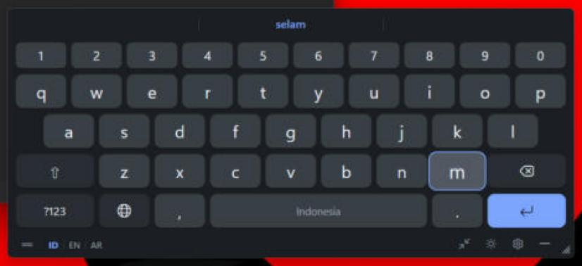
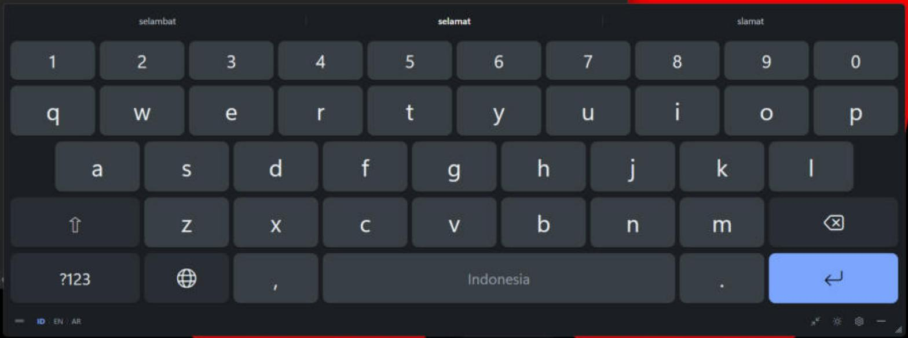
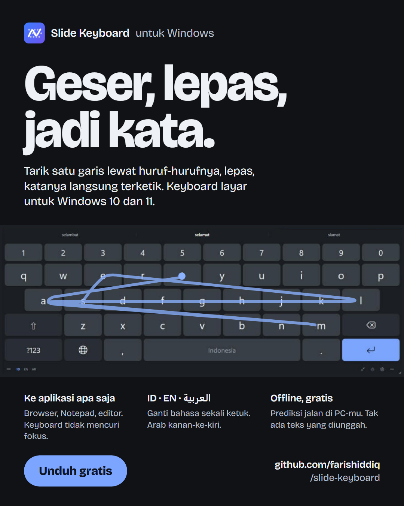

# Slide Keyboard

**Swipe-to-type on Windows.** A floating on-screen keyboard for Windows 10/11 with real swipe typing
(press, slide across the letters, release) for **Indonesian, English and Arabic**. It types into the app you
are using: browsers, Notepad, editors, regular Windows text fields.

Prediction runs entirely on your PC. Nothing you type is uploaded or saved.

**Download:** [latest release](https://github.com/farishiddiq/slide-keyboard/releases/latest) (`SlideKeyboard-<version>-win-x64.msi`)

## Screenshots

Swiping s‑e‑l‑a‑m‑a‑t: the suggestion bar shows the live guess while the key under the pointer grows.



After releasing, the word is typed and the alternatives stay in the bar (selamat · selambat · slamat).



<p align="center">
  
</p>

## Features

- **Swipe typing**: draw one stroke across the letters of a word and release. The whole gesture is matched
  against the dictionary using path shape, the keys you passed, sharp turns and pauses, word frequency and the
  previous word. It tolerates sloppy paths, and the live best guess shows while you swipe.
- **Three languages**: Indonesian and English (QWERTY) and Arabic (standard Arabic layout, right-to-left, Arabic
  punctuation and digits). Switch with the `ID | EN | AR` button, the globe key or `Ctrl+Space`.
  English/Indonesian can switch automatically from the words you swipe.
- **Suggestions and auto-correct**: 3 or 5 suggestions above the keys, word completion, next-word predictions,
  keyboard-aware typo correction (backspace right after a correction undoes it).
- **Personal dictionary**: type a new word, tap it (in quotes) in the suggestion bar, then **+ Save**. Saved words
  are suggested and swipeable; manage them in Settings.
- **Works with any app**: the keyboard never takes focus, so the app you are typing in stays active.
- **Floating window**: drag to move, resize from the corner, full or compact layout, minimize to a small
  bubble (`Ctrl+Alt+K`), always on top.
- **Settings**: light/dark/system theme, keyboard size, key height, opacity, swipe trail, key preview, sound,
  vibration (if the PC has a vibration device), auto-capitalization, double-space period, start with Windows,
  keyboard position.
- **Typing helpers**: long-press for accents and digits, drag the space bar to move the caret, hold backspace to repeat.

## Install

1. Download `SlideKeyboard-<version>-win-x64.msi` from the
   [releases page](https://github.com/farishiddiq/slide-keyboard/releases/latest).
2. Run it. It installs for your user account (no administrator rights needed) and adds Start Menu and
   desktop shortcuts. The .NET runtime is included.
3. Start **Slide Keyboard**, click into a text field in any app, and swipe.

Uninstall from **Settings > Apps > Installed apps**. Your settings and personal dictionary stay in
`%APPDATA%\SlideKeyboard` (delete that folder to remove them).

> The installer is not code-signed, so Windows SmartScreen may show "Windows protected your PC".
> Choose **More info > Run anyway**.

## Build from source

Requires the .NET 8 SDK on Windows.

```
dotnet build SlideKeyboard.sln -c Release
dotnet test tests/SlideKeyboard.Core.Tests -c Release
dotnet run --project src/SlideKeyboard.App -c Release
```

Build the installer (needs the WiX toolset: `dotnet tool install --global wix`):

```
powershell -ExecutionPolicy Bypass -File installer/build.ps1
```

The MSI is written to `artifacts/`.

## How it works

| Area | Location |
|---|---|
| Keyboard UI: key rendering, gestures, swipe trail | `src/SlideKeyboard.App/Controls/KeyboardSurface.cs`, `Views/` |
| Text injection into the focused app | `src/SlideKeyboard.App/Injection/WindowsTextOutput.cs` |
| Settings, themes, tray icon, startup | `src/SlideKeyboard.App/Settings`, `Theming`, `Services` |
| Layouts built from language packs | `src/SlideKeyboard.Core/Layout` |
| Swipe recognition (UI-independent, unit-tested) | `src/SlideKeyboard.Core/Swipe` |
| Completion, correction, next-word prediction | `src/SlideKeyboard.Core/Prediction` |
| Typing session and engine | `src/SlideKeyboard.Core/Input` |
| Language packs | `dictionaries/<code>/` (manifest.json, layout.json, words.txt, bigrams.txt) |

**Text injection.** Characters are posted as keyboard messages to the focused control, so a busy app cannot mix
them up. UWP/WinUI input surfaces fall back to `SendInput` Unicode input; Settings > Typing method can force it.
Windows does not allow typing into apps running as administrator.

**Language packs.** Each language is a folder with a manifest, a layout and word lists. Put a pack folder in
`%APPDATA%\SlideKeyboard\dictionaries\<code>` to add a language or override a bundled one.

**Word lists.** `words.txt` is generated by `tools/DictionaryBuilder` from the
[FrequencyWords](https://github.com/hermitdave/FrequencyWords) lists (OpenSubtitles 2018, CC BY-SA 4.0). It keeps
the 40–50k most frequent words, plus rarer words only when they are a known word with regular affixes
(Indonesian me-/di-/ber-…-kan/-nya, English -s/-ed/-ing, Arabic ال/و/ب…ه/ها/ات). These are merged with the
hand-written `starter.txt` lists. To rebuild:

```
dotnet run -c Release --project tools/DictionaryBuilder -- <folder with en_full.txt id_full.txt ar_full.txt>
```

Current sizes: Indonesian ~59k, English ~70k, Arabic ~130k words.

**Tuning recognition.** Settings > Troubleshooting > *Record swipes* (off by default) logs swipes and the
correction you picked to `%APPDATA%\SlideKeyboard\gestures.log`. `tests/.../Fixtures/real-swipes-id.txt` holds
labeled real mouse swipes that the tests replay.

## Privacy

- No network access. Prediction and dictionaries are local.
- The keyboard remembers only the last few characters it typed, in memory, to handle spacing and corrections.
  It forgets them when focus changes.
- Only words you explicitly save are stored (personal dictionary). The swipe log exists only if you turn it on.

## Known limitations

- Not code-signed (SmartScreen warning on first run).
- The keyboard cannot see text that is already in the field. If you move the caret with the physical mouse, spacing
  and corrections may guess wrong until you click into another field.
- Word frequencies come from movie subtitles, so conversational words rank high and some names appear.
- Haptic feedback needs a Windows vibration device; most desktops have none.

## License

Code: [MIT](LICENSE). Word lists: CC BY-SA 4.0, derived from FrequencyWords by Hermit Dave (see [LICENSE](LICENSE)).
